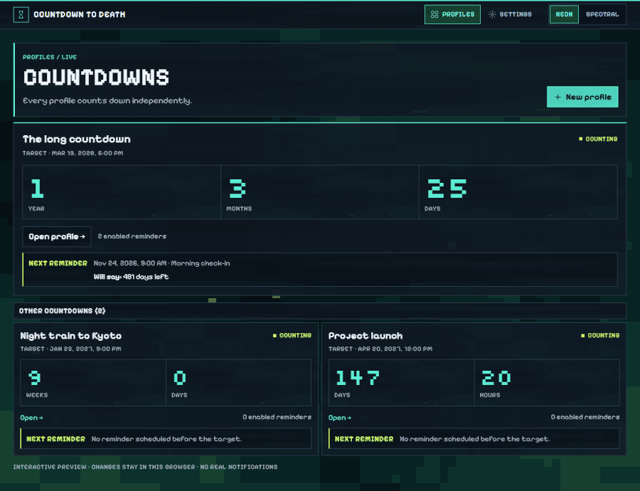
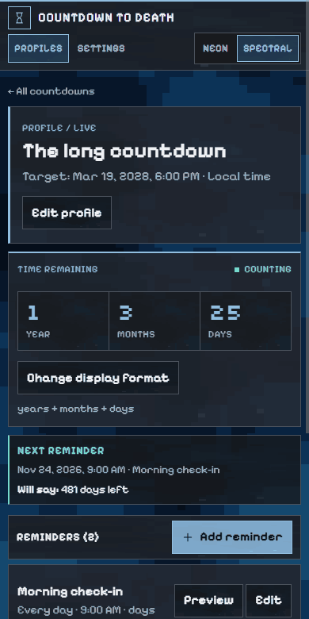

# Countdown to Death

A local-first countdown app for Android, Windows, and Linux. Set an exact target date and time, pick how to display the time left, and schedule reminders in whatever units make sense to you.

[Download the latest release](https://github.com/YukiYuziriha/countdown-to-death/releases/latest)

| Platform | Download | Install |
| --- | --- | --- |
| Android 8.0+ | Signed `.apk` | Open the APK on your phone and allow installation from that source if prompted. |
| Windows x64 | `.exe` installer | Run the installer. It isn't Authenticode-signed, so Windows may show a SmartScreen warning. |
| Linux x86_64 | `.AppImage` | Make the file executable, then open it. For launch at login, keep the AppImage in a permanent location. |

## In action

### Desktop — Neon and Spectral

### Phone — Spectral

The recordings use fictional countdowns. New installs start empty. Both themes respect the system's reduced-motion setting.

## What it does

- Keep multiple countdowns active at once, each with its own target and reminders.
- Show years through seconds, as a single total or any combination. The profile display and each notification have separate formats.
- Schedule one-time, daily, weekly, or monthly reminders. **Next reminder** shows when the alert will fire and what it will say at that time. Turn on **Time’s up** for a final notification at the target.
- Close the desktop window to keep reminders running in the tray. Launch at login is on by default and can be changed in Settings. **Quit** stops desktop reminders.
- On Android, enable **Notifications** and **Precise alarms** in the app’s Settings for on-time delivery. Without precise alarm access, Android may deliver reminders late.

Profiles and settings stay on your device. No account or cloud sync is required. Target and reminder times use the device’s local time zone.

## Build locally

- [Android build and signing instructions](android/README.md)
- [Windows and Linux build instructions](desktop/README.md)
- To preview the shared UI in a browser, open `ui-prototype.html`. The browser preview uses demo data and doesn’t send device notifications.

The UI uses [Pixelify Sans](assets/PixelifySans-OFL.txt) and [Silkscreen](assets/Silkscreen-OFL.txt), both under the SIL Open Font License.
